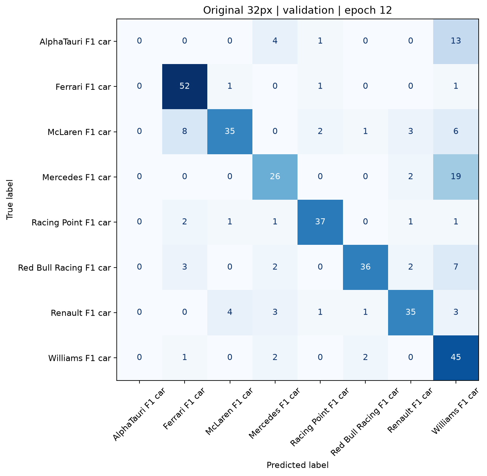
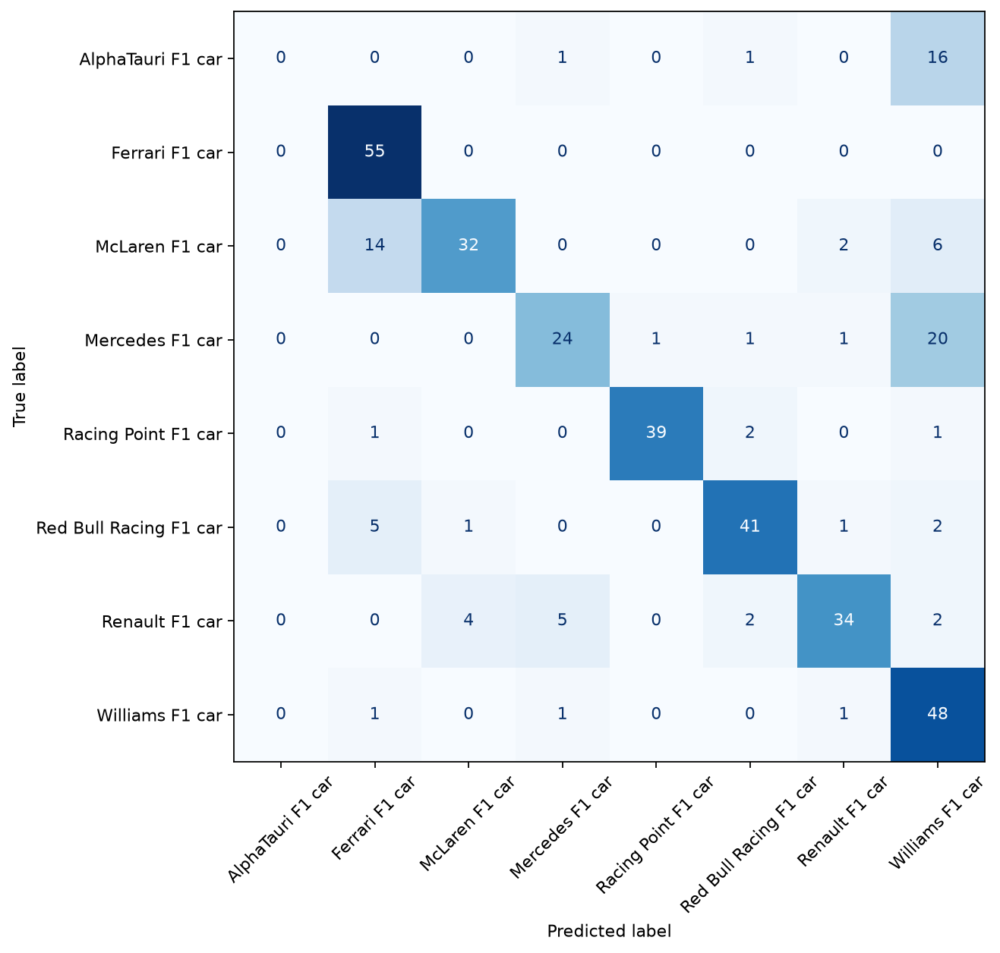
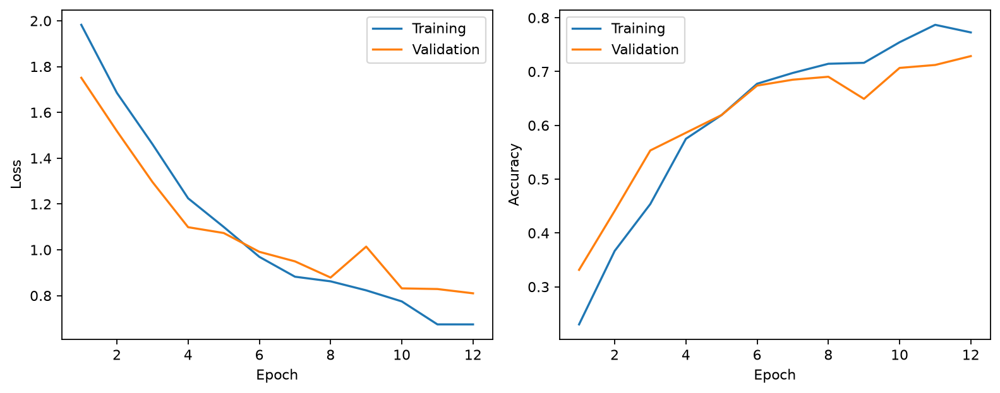
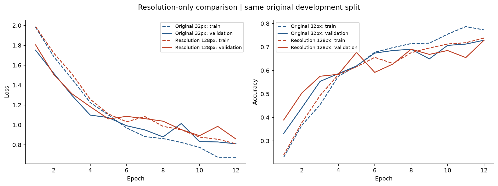
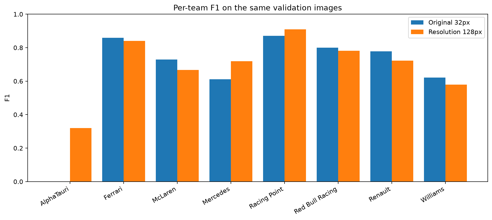
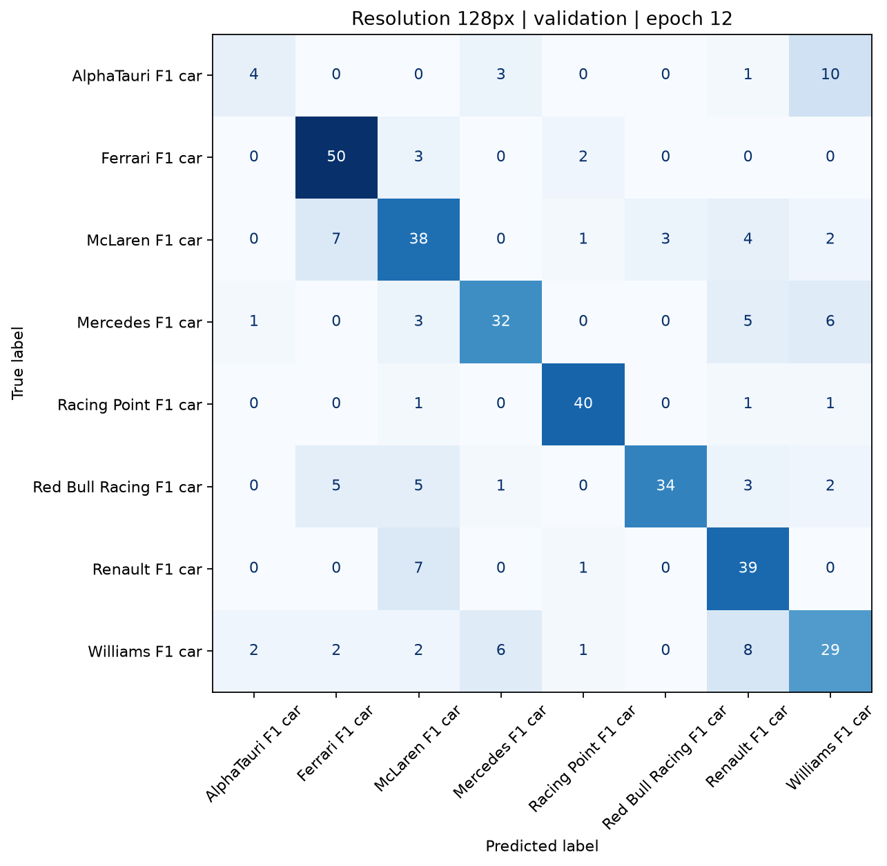

# F1 CNN experiment log

Evidence recorded 12 October 2026. Percentages below are measured unless explicitly labelled as a hypothesis or estimate.

## Preserved original baseline

Source: `runs/local_original_32px`, completed 11 October 2026. The selected model was `baseline/best.pt`, epoch 12. Original artifacts remain in place. A complete second copy, including every original checkpoint, configuration, split manifest, history, metrics and figure, is in [evidence/baseline](evidence/baseline/). SHA-256 checksums in [baseline_hashes.json](evidence/baseline_hashes.json) verify both copies. The original model, preprocessing, inference, configuration and trainer source are also preserved in [original_source](evidence/original_source/). `app.py` and `runs/latest.json` continue to load the original model.

The actual trained input was **32 × 32**, not the current package default of 64 × 64. The CNN was built from scratch: three blocks of two convolution/ReLU layers with 32, 64 and 128 channels, each followed by max pooling; global average pooling, dropout and a linear eight-class head. No pretrained weights.

| Setting | Original | Initial resolution experiment |
| --- | --- | --- |
| Image size | 32 × 32 | **128 × 128** |
| Batch size | 32 | 32 |
| Maximum epochs | 12 | 12 |
| Optimiser / loss | Adam / cross entropy | Unchanged |
| Learning rate | 0.001 | 0.001 |
| Weight decay | 0.0001 | 0.0001 |
| Dropout | 0.30 | 0.30 |
| Early-stopping patience | 4 epochs | 4 epochs |
| Checkpoint selection | Minimum validation loss | Unchanged |
| Seed | 42 | 42 |
| Augmentation | None | None |
| Input normalisation | RGB mean/std 0.5; square resize | Unchanged |
| Cache / loader workers | Resized RGB cache / 0 | Unchanged |
| Architecture / initialisation | Original CNN; Kaiming/Xavier | Unchanged |
| Device | CPU; 4 threads documented | CPU; 4 threads |

Original configuration: [config.json](evidence/baseline/baseline/config.json). Original environment: [environment.json](evidence/baseline/environment.json). [The prior verification record](VERIFICATION.md) documents four CPU threads, although the original environment JSON omitted the thread count. Caching, system load and timing boundaries still limit exact runtime comparisons.

Dataset: **2,429** audited images across eight teams; **1,699 train / 365 validation / 365 test**. Class totals: AlphaTauri 119, Ferrari 367, McLaren 362, Mercedes 310, Racing Point 285, Red Bull Racing 335, Renault 315, Williams 336. Reuse the exact saved manifest and order; do not resplit. Verify decoded-pixel hashes for development images before training and reject split overlap. Test manifest entries are checked for overlap without opening their images.

| Metric | Original validation | Original test (historical only) |
| --- | ---: | ---: |
| Accuracy | 72.88% | 74.79% |
| Macro F1 | 65.87% | 67.40% |
| Balanced accuracy | 67.00% | 68.68% |
| Best validation loss | 0.8101 | Not saved |
| Best epoch | 12 | Same epoch-12 checkpoint |

Baseline ran all 12 epochs; early stopping did not trigger. Its epoch timers total approximately 4.69 minutes, including a 188-second first epoch. Later epochs took approximately 8–11 seconds. These timers include data loading/training/validation but exclude checkpoint writes and report export. Historical three-fold development CV: accuracy 72.58% ± 1.09 percentage points and macro F1 67.50% ± 3.36 points (sample standard deviations, not confidence intervals). This CV followed configuration selection and is not nested or a new independent holdout.

### Per-team results and confusion matrix

| Team | Validation precision | Validation recall | Validation F1 | Validation support | Test F1 (historical) |
| --- | ---: | ---: | ---: | ---: | ---: |
| AlphaTauri | 0.00% | 0.00% | 0.00% | 18 | 0.00% |
| Ferrari | 78.79% | 94.55% | 85.95% | 55 | 83.97% |
| McLaren | 85.37% | 63.64% | 72.92% | 55 | 70.33% |
| Mercedes | 68.42% | 55.32% | 61.18% | 47 | 61.54% |
| Racing Point | 88.10% | 86.05% | 87.06% | 43 | 93.98% |
| Red Bull Racing | 90.00% | 72.00% | 80.00% | 50 | 84.54% |
| Renault | 81.40% | 74.47% | 77.78% | 47 | 79.07% |
| Williams | 47.37% | 90.00% | 62.07% | 50 | 65.75% |

Full numerical matrices and per-team reports: [validation](evidence/baseline/baseline/validation_metrics.json), [historical test](evidence/baseline/test_metrics.json).

Report tables: [per-team metrics CSV](evidence/baseline_per_team.csv), [validation matrix CSV](evidence/baseline_validation_confusion_matrix.csv), [historical test matrix CSV](evidence/baseline_historical_test_confusion_matrix.csv), [historical experiment comparison CSV](evidence/historical_comparison.csv).







**Measured validation confusions:** Mercedes → Williams 19/47 (40.4%); AlphaTauri → Williams 13/18 (72.2%); McLaren → Ferrari 8/55 (14.5%); Red Bull Racing → Williams 7/50 (14.0%). Williams has high recall but low precision, accepting many other teams. AlphaTauri has zero recall and zero F1 on both recorded splits. The historical test matrix shows Mercedes → Williams 20, AlphaTauri → Williams 16 and McLaren → Ferrari 14. These existing test results are documented for completeness, not used to rank new candidates.

**User-reported example:** an AlphaTauri photo received a Williams model score of 72%. The source image was not supplied, so this individual prediction has not been independently reproduced. The saved validation confusions independently establish a similar failure pattern. A softmax score is not calibrated certainty.

### Overfitting and optimisation review

**Measured:** training loss fell from 1.9824 to 0.6743 and validation loss from 1.7512 to 0.8101. At epoch 12, training accuracy was 77.28% and validation accuracy 72.88%, a 4.40-point gap; the loss gap was 0.1358. Validation loss briefly rose at epoch 9 but recovered to its minimum at epoch 12. There is a modest generalisation gap, but no sustained validation deterioration demonstrating severe overfitting. The best epoch coincides with the budget limit, so additional learning is possible. Training metrics include active dropout and changing weights; validation metrics use evaluation mode, so these gaps are not a controlled train/evaluation comparison.

**Decision:** retain learning rate 0.001, dropout 0.30 and patience 4 for the first experiment. The available curves do not justify simultaneously reducing the learning rate or increasing dropout. Changing these alongside resolution would obscure attribution. Retain the original epoch budget for comparison; higher resolution will have a larger compute budget, so this is not a compute-matched study.

**Historical augmentation evidence:** the already completed 32px flip/rotation run used horizontal flips (probability 0.5) and ±10° rotations. Validation accuracy was 71.23% and macro F1 63.99%, below the unaugmented baseline by 1.64 and 1.88 points. It ran 12 epochs, selected epoch 12 with validation loss 0.8733, and its epoch timers totalled 3.92 minutes. All saved training settings except augmentation match the baseline. Its [configuration](evidence/baseline/augmented/config.json), [history](evidence/baseline/augmented/history.json) and [curves](evidence/baseline/augmented/learning_curves.png) are preserved. This is one past run, not evidence that all augmentation is harmful. Brightness/contrast adjustment has not yet been tested.

## R01: resolution only — protocol fixed before training

Change input resolution from 32 × 32 to **128 × 128**. Keep every other setting in the table fixed and initialise a fresh copy of the original architecture using seed 42. Adaptive global pooling already supports this input size without changing model parameters.

**Hypothesis:** 32px resizing may remove useful livery and logo details. Higher resolution may improve discrimination. Visual similarity, class imbalance, backgrounds and global averaging remain alternative explanations for errors; this experiment cannot prove which features the CNN uses.

Preflight benchmark: CPU, four threads, batch size 32; five synthetic training batches and one validation batch using a disposable model. Training batches: 2.229, 1.904, 1.764, 1.742, 1.766 seconds; validation: 0.723 seconds. Warm-epoch estimate: 54 training batches × median of the last four timings + 12 validation batches ≈ **104 seconds**. Twelve epochs ≈ **20.8 minutes**, with an estimated **23–28 minutes total** allowing data verification/loading and evidence export. This is an estimate, not a measured full training time; short-batch extrapolation can underestimate sustained cost. No benchmark weights are retained for the experiment.

Run at most 12 epochs and restore minimum validation-loss weights; stop after four consecutive epochs without improvement. Compare restored-checkpoint validation macro F1 first, then accuracy for an exact F1 tie. Record balanced accuracy, per-team metrics and validation loss as additional evidence. Do not open or evaluate test images. Do not run the existing full training suite, which would run several models and evaluate the test set. Do not automatically promote the candidate in the application.

Reproduce from the project root:

```powershell
.\venv\Scripts\python.exe -m f1_cnn.experiments --output runs/resolution_128_seed42 --benchmark .cache/experiments/resolution_benchmark.json
```

Use a fresh output name for any rerun; existing results are rejected. The runner exports configuration, environment/source hashes, original-manifest hash, epoch durations, metrics, predictions, error examples, curves, confusion matrices, a comparison CSV and per-team CSV, and appends the measured outcome below. It never writes `runs/latest.json`. Both model checkpoints remain loadable through **Load model** in `app.py`.

## Remaining limitations and staged future work

Only one new experiment is included in this initial comparison. Report its outcome before starting another run. Planned changes below have **not** been trained or measured:

1. If warranted by the first result, test moderate brightness/contrast only (e.g. `ColorJitter(brightness=0.15, contrast=0.15)`), without hue/saturation changes that could erase team colours. Use training images only, keeping validation deterministic.
2. Test small rotations (e.g. ±5°) and horizontal flips (probability 0.5) in separate comparisons. Flips mirror logos/text; rotation creates artificial borders. Their benefits must be measured, particularly given the lower historical combined-augmentation score.
3. Review the new curves before changing optimisation. A separate longer-budget or reduced-learning-rate experiment may help if still learning; a dropout adjustment is justified only by stronger evidence of overfitting. Retain early stopping and change one setting per run.
4. AlphaTauri has far fewer examples. Audit training labels, obtain more diverse examples or separately test class-weighted cross entropy. Do not infer the cause of zero recall solely from the class counts.
5. Confirm promising settings across seeds or development folds when time allows. One seed and 365 validation images cannot establish reliable superiority; repeated validation tuning can itself overfit.
6. Pixel hashes remove exact duplicate pixels, not near-duplicates, race sequences or alternate crops. Future source/race-grouped splits and a fresh external holdout would better measure generalisation. Existing test results have already informed discussion, so the old test set is not a pristine final research holdout even though no new test evaluation is performed here.
7. Square resizing distorts aspect ratios; global average pooling can discard local details. Background shortcuts, changing seasons/liveries, ambiguous labels and uncalibrated model scores remain limitations. The CNN does not locate the car or reject unknown classes.

Do not claim that a candidate exceeds **74.8% test accuracy** based on a validation result. A final frozen choice needs an appropriately independent evaluation to support that claim.

## resolution_128_seed42 — measured outcome

Only image size changed: **32 × 32 → 128 × 128**. All other configuration values, split membership/order, seed, model and checkpoint-selection rule were retained.

| Validation metric | Original 32px | Resolution 128px |
| --- | ---: | ---: |
| Accuracy | 72.88% | 72.88% |
| Macro F1 | 65.87% | 69.24% |
| Balanced accuracy | 67.00% | 69.04% |
| Best validation loss | 0.8101 | 0.8580 |
| Best epoch / epochs run | 12 / 12 | 12 / 12 |
| Training time (sum of epoch timers) | 4.69 min | 24.03 min |

Experiment wall time including verification/export: 27.92 min (excludes the separate preflight benchmark and final comparison rendering).

Validation macro F1 changed by +3.37 percentage points; accuracy changed by +0.00 points. By the predeclared validation macro-F1/accuracy rule, the candidate is preferred. The application still defaults to the preserved original checkpoint.

**Measured:** This is one seed on 365 validation images. The candidate has no test score; exceeding the historical 74.79% test accuracy has not been established. Epoch training metrics include dropout and changing weights, so their gap against evaluation-mode validation metrics is only an approximate overfitting indicator.

**Possible explanation:** More input detail may help distinguish liveries, but higher resolution alone does not remedy label imbalance, background shortcuts or global pooling. A single run cannot isolate these mechanisms or establish statistical reliability.

Checkpoint: `C:\Users\tyqnn\PycharmProjects\CNNProject\runs\resolution_128_seed42\best.pt` (load manually with app.py).







Tables: [comparison](evidence/resolution_128_seed42/comparison.csv), [per-team metrics](evidence/resolution_128_seed42/per_team_validation.csv).

### Interpretation of the completed resolution experiment

**Measured improvements:** AlphaTauri recall increased from 0/18 to **4/18 (22.22%)**, with F1 increasing from 0.00% to **32.00%**. AlphaTauri → Williams mistakes decreased from 13 to 10, so this remains the candidate's largest directional confusion. Mercedes → Williams mistakes decreased from **19 to 6**, and Mercedes F1 rose from **61.18% to 71.91%**. Racing Point F1 rose from 87.06% to 90.91%. Balanced accuracy increased by 2.04 percentage points.

**Measured trade-offs:** F1 fell for Ferrari (85.95% → 84.03%), McLaren (72.92% → 66.67%), Red Bull Racing (80.00% → 78.16%), Renault (77.78% → 72.22%) and Williams (62.07% → 58.00%). Williams recall fell from 45/50 to 29/50; its most common new destination was Renault (8 mistakes). The gain is therefore concentrated in three teams, especially AlphaTauri, rather than a uniform improvement.

Both models classified **266/365** validation images correctly. A paired comparison found 234 images correct for both, 32 correct only for the original, 32 correct only for the candidate, and 67 wrong for both. Overall accuracy did not improve. The higher macro F1 reflects a different distribution of errors among teams. Validation loss worsened from 0.8101 to 0.8580; cross entropy uses predicted probabilities, while accuracy and F1 use the winning label, so these measures can move in different directions. No calibration improvement has been established.

**Curves and optimisation:** At epoch 12, candidate training accuracy was 73.81% versus 72.88% validation accuracy (0.93-point gap); training loss was 0.8105 versus 0.8580 validation loss (gap 0.0475). Validation loss was lowest at epoch 12 after intermittent spikes, so early stopping did not trigger and severe sustained overfitting is not evident. The smaller gap than the baseline does not itself prove better generalisation: candidate training performance was also lower. These curves do not support increasing dropout now. Additional convergence time or a lower learning rate might help, but that is an untested explanation requiring a separate experiment.

**Cost:** Epoch timers totalled **24.03 minutes**, approximately **5.13×** the original's 4.69 minutes. Median cached epoch time was 107.73 seconds versus 8.25 seconds (approximately 13.1×); first-epoch loading makes total and warmed-epoch ratios differ. Experiment wall time was **27.92 minutes**, near the upper end of the preflight 23–28-minute estimate. Timing is descriptive for this machine, not a controlled hardware benchmark.

**Decision:** retain the 128px checkpoint as the preferred *validation macro-F1 candidate*, while preserving the original default in `app.py`. The result supports further investigation of resolution for minority-team recognition, but does not establish better overall accuracy, reliable generalisation across seeds, or a fix for the user's particular AlphaTauri photograph. The historical 74.79% test accuracy has not been exceeded by a measured new test result.

**Next staged experiment, not yet run:** a moderate brightness/contrast-only comparison against the original 32px baseline would provide a cheaper independent augmentation test (0 → 0.15 brightness/contrast range, retaining all other settings). Do not combine it with resolution, rotation, flips or optimisation changes in that comparison. AlphaTauri label/data review and a separate class-weighting experiment are also justified follow-up candidates. Confirm any promising choice on additional development seeds before making a broad generalisation claim; keep the existing test set out of those decisions.
